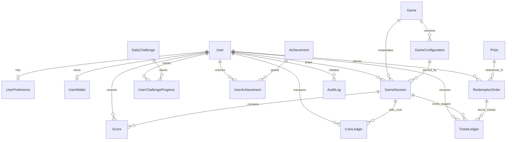

# ArcadeVerse — DATABASE.md (Phase 3.1 Architecture Specification)

**Milestone:** Phase 3.1 — Database Architecture Audit & Design  
**Status:** ✅ DESIGN VERIFIED  
**Engine:** SQLite (Write-Ahead Logging mode)  
**ORM:** Prisma 5 (Schema Client + Raw Transaction Safety)  
**Datasource:** `prisma/dev.db` (Gitignored)

---

## 1. Executive Summary & Core Principles

ArcadeVerse is a server-authoritative arcade gaming and prize redemption ecosystem. The database architecture enforces financial integrity, zero client trust, deterministic game configurations, and transactional atomicity.

### Core Architecture Rules:
1. **Server-Authoritative Ledger:** Balances are never updated through unchecked client inputs. Coin expenditures and ticket rewards are strictly append-only in `coin_ledger` and `ticket_ledger`.
2. **Deterministic Configuration Pinning:** Once a game configuration is published, it is immutable. A `GameSession` pins the active `configVersionId` at initialization. Mid-flight rule mutations are structurally prohibited.
3. **Idempotency Guarantees:** Every transactional mutation (session start, score recording, reward claim, prize redemption) requires a unique `idempotencyKey` preventing duplicate requests from mobile network retries.
4. **Optimistic O(1) Read Acceleration:** While ledgers provide an audit trail via `SUM(amount)`, `UserWallet` maintains an ACID-synchronized snapshot with an optimistic lock version for microsecond profile rendering.
5. **Phase 4 Pre-Architecture:** The prize catalog and redemption workflow are pre-modeled into this phase so that the transition to physical and digital prize fulfillment requires zero breaking migrations.

---

## 2. Entity-Relationship Architecture



---

## 3. Data Dictionary & Model Specifications

### 3.1 Identity & Access Domain

#### `User` (`users`)
- `id` (TEXT PK): Internal CUID; never exposed in URLs or client bundles.
- `userId` (TEXT UQ): Public gamer tag identifier (e.g., `AV-108291`).
- `phone` (TEXT UQ): Normalized E.164 phone string (e.g., `+959...`).
- `phoneVerified` (BOOLEAN): Mobile verification flag.
- `email` (TEXT UQ, Nullable): Secondary contact.
- `displayName` (TEXT): Gamer screen name.
- `passwordHash` (TEXT): Argon2id or bcrypt hash (10+ salt rounds).
- `role` (TEXT): Role-based access control (`user`, `operator`, `admin`).
- `status` (TEXT): Account lifecycle (`active`, `suspended`, `banned`).
- `deletedAt` (DATETIME, Nullable): Soft-deletion flag.

#### `UserPreference` (`user_preferences`)
- `userId` (TEXT UQ FK): Associated user.
- `language` (TEXT): `my` (Myanmar) or `en` (English).
- `soundEnabled` (BOOLEAN): Master audio toggle.
- `reducedMotion` (BOOLEAN): Accessibility animation toggle.
- `theme` (TEXT): Default `dark` (cyber arcade theme).

---

### 3.2 Dual-Currency Ledger Domain

#### `UserWallet` (`user_wallets`)
- `userId` (TEXT UQ FK): Associated user.
- `coinBalance` (INTEGER): Current spendable coin credits.
- `ticketBalance` (INTEGER): Current spendable ticket balance.
- `lifetimeCoinsEarned` (INTEGER): Cumulative lifetime metrics.
- `lifetimeCoinsSpent` (INTEGER): Cumulative lifetime coin spend.
- `lifetimeTicketsEarned` (INTEGER): Cumulative lifetime tickets earned.
- `lifetimeTicketsSpent` (INTEGER): Cumulative lifetime tickets burned.
- `version` (INTEGER): Optimistic concurrency token incremented on every write.

#### `CoinLedger` (`coin_ledger`)
- `id` (TEXT PK): CUID transaction entry.
- `userId` (TEXT FK): Owner.
- `sessionId` (TEXT FK, Nullable): Associated game session (if play cost).
- `amount` (INTEGER): Signed delta (`-N` for entry costs, `+N` for grants).
- `reason` (TEXT): `session_play_cost`, `daily_challenge`, `achievement`, `admin_adjustment`, `welcome_bonus`.
- `idempotencyKey` (TEXT UQ): Prevents double deduction under poor mobile connectivity.

#### `TicketLedger` (`ticket_ledger`)
- `id` (TEXT PK): CUID transaction entry.
- `userId` (TEXT FK): Owner.
- `sessionId` (TEXT FK, Nullable): Associated game session (if game reward).
- `redemptionId` (TEXT FK, Nullable): Associated prize redemption order.
- `amount` (INTEGER): Signed delta (`+N` for wins, `-N` for redemptions).
- `reason` (TEXT): `session_reward`, `daily_challenge`, `achievement`, `prize_redemption`, `admin_adjustment`.
- `idempotencyKey` (TEXT UQ): Guaranteed single issuance per outcome.

---

### 3.3 Game Catalog & Configuration Studio Domain

#### `Game` (`games`)
- `id` (TEXT PK): CUID.
- `slug` (TEXT UQ): Canonical slug (`game-01` to `game-04`).
- `name` / `nameMy` (TEXT): Bilingual titles.
- `shortDesc` / `shortDescMy` (TEXT): Bilingual summaries.
- `category` (TEXT): `arcade`, `casual`, `action`, `sports`.
- `accentTheme` (TEXT): Neon accent color token (`cyan`, `magenta`, `amber`, `green`).
- `status` (TEXT): `available`, `coming_soon`, `maintenance`.
- `modes` (TEXT): JSON array of supported presets (`["easy","hard","very_hard","very_very_hard","custom"]`).

#### `GameConfiguration` (`game_configurations`)
- `id` (TEXT PK): CUID.
- `gameId` (TEXT FK): Game reference.
- `version` (INTEGER): Monotonically increasing sequence per game.
- `state` (TEXT): Strict lifecycle state machine:
  $$\text{draft} \rightarrow \text{validating} \rightarrow \text{testing} \rightarrow \text{approved} \rightarrow \text{published} \rightarrow \text{rolled\_back}$$
- `rulesJson` (TEXT): Bounded gameplay parameters (JSON validated via Zod).
- `changeSummary` (TEXT, Nullable): Audit changelog description.
- `createdById` / `approvedById` (TEXT, Nullable): Admin / Supervisor signatures.
- `rollbackOfId` (TEXT, Nullable): Pointer to previous version if rolled back.

---

### 3.4 Session & Anti-Cheat Domain

#### `GameSession` (`game_sessions`)
- `id` (TEXT PK): Session identifier.
- `userId` (TEXT FK): Player.
- `gameId` (TEXT FK): Game played.
- `configVersionId` (TEXT FK): **Pinned configuration version.**
- `difficulty` (TEXT): `easy`, `hard`, `very_hard`, `very_very_hard`, `custom`.
- `status` (TEXT): `active`, `finished`, `abandoned`.
- `playCostCoins` (INTEGER): Pinned coin deduction at game start.
- `startedAt` (DATETIME): Server timestamp when gameplay initialized.
- `finishedAt` (DATETIME, Nullable): Server timestamp when round completed.
- `durationMs` (INTEGER, Nullable): Enforced round timer.
- `finalScore` (INTEGER, Nullable): Server-calculated score.
- `rewardTickets` (INTEGER, Nullable): Server-calculated reward.
- `idempotencyKey` (TEXT UQ, Nullable): Deduplication token for round completion.

#### `Score` (`scores`)
- `id` (TEXT PK): Score event record.
- `sessionId` (TEXT FK): Parent game session.
- `userId` (TEXT FK): Scoring player.
- `score` (INTEGER): Points accrued for this step.
- `clientRef` (TEXT UQ, Nullable): Client-side event nonce preventing duplicate hits.
- `metadataJson` (TEXT, Nullable): Reaction time (ms), target coordinate, hit accuracy telemetry.

---

### 3.5 Prize & Redemption Domain (Phase 4 Foundation)

#### `Prize` (`prizes`)
- `id` (TEXT PK): CUID.
- `slug` (TEXT UQ): URL friendly identifier.
- `title` / `titleMy` (TEXT): Bilingual item names.
- `description` / `descriptionMy` (TEXT): Bilingual descriptions.
- `ticketCost` (INTEGER): Required ticket burn.
- `stockQuantity` (INTEGER): Real-time stock available.
- `category` (TEXT): `digital`, `plush`, `electronics`, `voucher`.
- `status` (TEXT): `draft`, `active`, `out_of_stock`, `discontinued`.

#### `RedemptionOrder` (`redemption_orders`)
- `id` (TEXT PK): CUID.
- `orderNumber` (TEXT UQ): User facing receipt code (`ORD-XXXXXX`).
- `userId` (TEXT FK): Redeeming player.
- `prizeId` (TEXT FK): Selected prize.
- `ticketsSpent` (INTEGER): Tickets deducted.
- `status` (TEXT): `pending`, `approved`, `processing`, `fulfilled`, `rejected`, `refunded`.
- `recipientName` / `recipientPhone` / `shippingAddress` (TEXT): Fulfillment details.
- `idempotencyKey` (TEXT UQ): Prevents duplicate submissions.

---

### 3.6 Gamification & Compliance Domain

#### `DailyChallenge` (`daily_challenges`) & `UserChallengeProgress`
- Tracks daily player quotas with time windows (`startsAt`, `endsAt`).
- Bounded rewards in coins and tickets.
- Idempotency key prevents repeated reward claims.

#### `Achievement` (`achievements`) & `UserAchievement`
- Milestone achievements per game and across the platform.
- Unlocked once per user via unique compound index `@@unique([userId, achievementId])`.

#### `AuditLog` (`audit_logs`)
- Immutable log for all administrative state modifications (`config.publish`, `balance.adjust`, `user.suspend`, `redemption.status`).
- Stores `beforeJson` and `afterJson` payloads.

---

## 4. SQLite Optimization & Concurrency Strategy

To ensure zero database lock contention on Termux / Linux ARM64:

```sql
-- Executed on database connection initialization:
PRAGMA journal_mode = WAL;
PRAGMA busy_timeout = 5000;
PRAGMA foreign_keys = ON;
PRAGMA synchronous = NORMAL;
PRAGMA cache_size = -64000; -- 64MB memory cache
```

### Transaction Boundary Rules:
1. **Game Start Transaction:**
   ```sql
   BEGIN IMMEDIATE;
   -- 1. Check user coin balance >= game.playCost
   -- 2. Insert into coin_ledger (-playCost, reason: 'session_play_cost')
   -- 3. Update user_wallets (coinBalance = coinBalance - playCost, version = version + 1)
   -- 4. Insert into game_sessions (status: 'active', configVersionId: activeConfig.id)
   COMMIT;
   ```
2. **Game Finalize Transaction:**
   ```sql
   BEGIN IMMEDIATE;
   -- 1. Validate session status == 'active' AND session.userId == auth.userId
   -- 2. Validate round durationMs <= config.maxDuration + tolerance
   -- 3. Calculate tickets = computeReward(finalScore, config.rules)
   -- 4. Update game_sessions (status: 'finished', finalScore, rewardTickets)
   -- 5. Insert into ticket_ledger (+rewardTickets, reason: 'session_reward')
   -- 6. Update user_wallets (ticketBalance = ticketBalance + rewardTickets, version = version + 1)
   COMMIT;
   ```

---

## 5. Verification Checklist for Phase 3.1
- [x] Schema syntax verified against Prisma 5.x specification.
- [x] Both languages (English / Myanmar) modeled in catalog and prize domains.
- [x] Append-only ledger architecture isolates financial mutations from client tampering.
- [x] Configuration versioning state machine guarantees historical replay integrity.
- [x] Prize redemption tables pre-modeled for Phase 4.
- [x] Compound indexes applied to all query hot-paths (leaderboards, session queries, ledger history).
